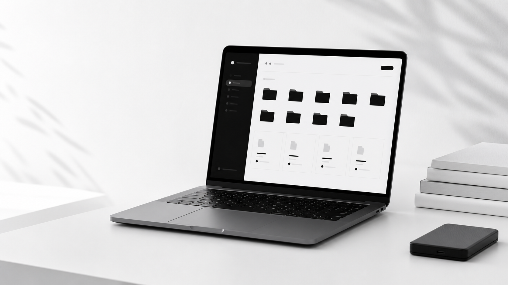
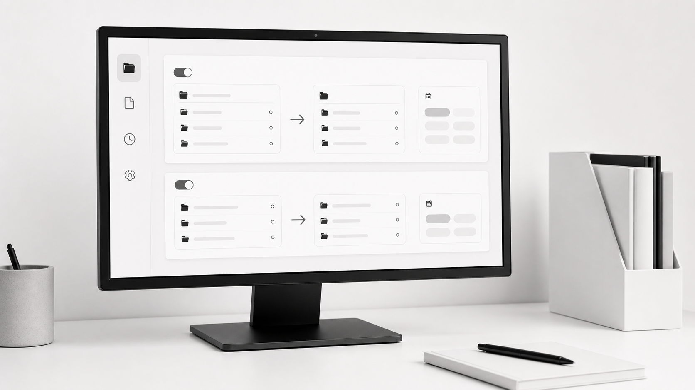
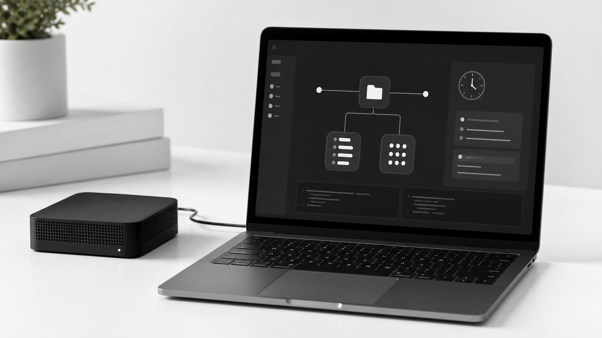

# Shelfy


Minimal, privacy-first local file automation, folder organization, and AI agent workflows.



Shelfy is a desktop utility built with Tauri (Rust + React) that keeps your Downloads, Documents, and workspace folders clean and organized. It runs silently from your system tray, applies real-time rules to incoming files, and provides an advanced YAML workflow engine (**Orden**) for multi-step batching, archiving, and scheduled automations.

---

## Highlights

- **Dual-Engine Architecture**:
  - **Simple Rules**: Low-latency, real-time folder watcher and organizer backed by SQLite.
  - **Orden Engine**: Full-fledged file automation pipeline with filters, sequential actions, template variables, and conflict policies.
- **Clean by Default**: Starts clean without unwanted sample rules or ghost configurations polluting your workspace.
- **Visual Pipeline & Source Dual-Mode**:
  - **Visual Mode**: Card-based flow (`Source -> Filter Conditions -> Action Pipeline`) with typed parameter editors.
  - **Source Mode**: Direct YAML editing with live schema validation.
- **Template Center**:
  - Built-in system recipes (Organize Images, Documents, Archives, Auto-unpack, Backup, Cleanup).
  - Custom templates with one-click creation, import, and export.
- **Flexible Automation Triggers**:
  - `manual`: On-demand execution.
  - `fixed`: Scheduled daily at a specific time.
  - `cron`: Standard 5-field cron cadence.
  - `interval`: Triggered every $N$ minutes from the last successful run.
  - `monitor`: Triggered automatically when new matching files enter watched directories.
  - **Pre-execution Confirmation**: Review simulated match count and safety checks before applying destructive file actions.
- **Local Model Context Protocol (MCP)**:
  - Exposes local file intelligence and workflow automation to AI clients (Claude Desktop, Cursor, OpenCode) via `shelfy --mcp`.
  - Read-only simulation by default; write permissions require explicit user consent.
- **System Tray & Keepalive**:
  - Native background daemon with macOS LaunchAgent and Windows Task Scheduler keepalive installers.
  - Theme-adaptive interface with seamless Light and Dark mode support.
- **Local Sovereignty**: All metadata, rules, configurations, and logs remain strictly on your machine in local SQLite and YAML files.

---

## Visual Rules & Orden Engine

Use the visual editor to inspect and assemble file workflows intuitively:



### Orden YAML Workflow Example

For power users, switch to **Source** mode to edit the Orden YAML directly:

```yaml
rules:
  - name: "Back up PDFs"
    targets: files
    locations:
      - ~/Downloads
      - ~/Documents/Incoming
    subfolders: true
    filters:
      - extension: [pdf]
    actions:
      - copy: ~/Documents/Shelfy Backups/PDF/
      - copy: /Volumes/Archive/PDF/
```

### Supported Filters & Actions

| Category | Available Modules |
| --- | --- |
| **Filters** | `extension`, `name` (glob), `regex` (named capture groups), `size`, `empty`, `mimetype`, `hash` (md5/sha1/sha256), `duplicate`, `created`, `lastmodified`, `filecontent` (text/code/docx/pdf), `exif`, `archivefile` |
| **Actions** | `move`, `copy` (multi-destination fan-out), `rename`, `trash`, `delete`, `echo`, `write` (append/prepend/overwrite), `extract` (ZIP/7z/RAR with password list, auto-recursion, volume detection), `compress`, `symlink`, `hardlink`, `shell` |

---

## Local AI / MCP Integration

Shelfy integrates with the **Model Context Protocol (MCP)** over stdio, enabling AI agents to safely read file structures, simulate workflows, and orchestrate rules.



### Launching MCP

```bash
# Launch stdio MCP server
shelfy --mcp

# Print operational guide and schema
shelfy --mcp --help
```

### Claude Desktop Configuration

Add the following to your `claude_desktop_config.json`:

```json
{
  "mcpServers": {
    "shelfy": {
      "command": "shelfy",
      "args": ["--mcp"]
    }
  }
}
```

### Available MCP Tools

| Tool | Permission | Description |
| --- | --- | --- |
| `shelfy_list_folders` | Read | List watched directories and monitoring modes |
| `shelfy_list_rules` | Read | List active SQLite basic sorting rules |
| `shelfy_recent_logs` | Read | Fetch recent file organization and undo history |
| `shelfy_list_orden_configs` | Read | List all saved Orden workflow configurations |
| `shelfy_get_orden_config` | Read | Read raw YAML for a specific Orden config |
| `shelfy_list_orden_jobs` | Read | List automation jobs, schedules, and triggers |
| `shelfy_orden_history` | Read | Query execution logs and error details |
| `shelfy_orden_simulate` | Read | Dry-run a configuration safely without touching files |
| `shelfy_save_orden_config` | Write (Opt-in) | Create or update an Orden YAML configuration |
| `shelfy_save_orden_job` | Write (Opt-in) | Configure a scheduled or monitored automation job |
| `shelfy_scan_folder` | Write (Opt-in) | Trigger an immediate scan on a directory |
| `shelfy_orden_run` | Write (Opt-in) | Execute real file modifications with user authorization |

> **Security Note**: Write tools are disabled by default. Enable `mcp_allow_write` in **Settings → MCP** to allow AI clients to write configs or perform real file operations.

---

## CLI Reference

On macOS, Shelfy automatically installs a terminal symlink at `~/.local/bin/shelfy` upon launch. The explicit `--cli` flag is also supported when invoking the raw application binary directly.

### Everyday Organization & Rules

```bash
# Scan a folder against simple rules
shelfy scan ~/Downloads

# Manage simple rules
shelfy rules list
shelfy rules export ~/Desktop/shelfy-rules.json
shelfy rules import ~/Desktop/shelfy-rules.json [--replace]

# Manage watched folders
shelfy folders list
shelfy folders add ~/Downloads [silent|manual|paused]
shelfy folders mode <folder_id> <silent|manual|paused>

# Manage app settings
shelfy config path
shelfy config export ~/Desktop/shelfy-config.json
shelfy config import ~/Desktop/shelfy-config.json [--replace]
```

### Orden Workflow Engine

```bash
# Validate YAML syntax and step schemas
shelfy orden check /path/to/workflow.yaml

# Simulate execution (dry-run without modifying files)
shelfy orden sim /path/to/workflow.yaml [--tags t1,t2] [--skip-tags t3] [--working-dir <dir>]

# Execute real workflow actions
shelfy orden run /path/to/workflow.yaml [--tags t1,t2] [--skip-tags t3] [--working-dir <dir>]
```

*(The `organize` namespace is accepted as a drop-in alias for `orden`)*.

---

## Installation on macOS

Shelfy distributes Universal macOS builds (Apple Silicon & Intel). Install and update via Homebrew:

```bash
# Add tap and install
brew tap mcxen/shelfy https://github.com/mcxen/shelfy.git
brew install --cask mcxen/shelfy/shelfy

# Upgrade to latest
brew upgrade --cask --greedy-latest mcxen/shelfy/shelfy
```

### In-App Updates & Gatekeeper

- **In-App Updates**: You can check for updates and trigger in-place installation in **Settings → General**.
- **Gatekeeper Notice**: Pre-release builds use ad-hoc code signing. If macOS displays a Gatekeeper prompt on initial run, navigate to **System Settings → Privacy & Security** and select **Open Anyway**.

---

## Architecture & Storage

```text
React 19 + TypeScript UI (Tailwind CSS + coss primitives)
  │ (Tauri 2 IPC invoke / events)
Rust Core
  ├─ watcher (notify crate, grace period & file lock debouncing)
  ├─ rules engine (instant regex/extension matching)
  ├─ Orden YAML engine (lexer, AST, pipeline walker, template engine)
  ├─ scheduler & keepalive (macOS LaunchAgent / Windows Task Scheduler)
  └─ stdio MCP server (JSON-RPC 2.0)
  │
Persistence
  ├─ SQLite (<data_dir>/shelfy.db: rules, folders, logs, undo, jobs, settings)
  └─ YAML storage (<data_dir>/orden/*.yaml and <data_dir>/orden/templates/*.yaml)
```

For comprehensive technical documentation, refer to:
- [`public/architecture/README.md`](public/architecture/README.md) — Architectural boundary, execution pathways, and visual pipeline specifications.
- [`RESEARCH.md`](RESEARCH.md) — Upstream organize-tool comparison, filter/action semantics, and technical decisions.
- [`TASK.md`](TASK.md) — Engine implementation roadmap, milestones, and task tracking.

---

## Development

### Prerequisites

- **Rust**: Stable toolchain (`rustc`, `cargo`)
- **Node.js**: Node 22+ & npm
- **Platform Dependencies**: Standard Tauri prerequisites for macOS/Linux/Windows

### Setup & Run

```bash
# Install frontend dependencies
npm install

# Start development app with hot-reloading
npm run tauri dev
```

### Build & Test

```bash
# Typecheck & build frontend
npm run build

# Run Rust unit and integration tests
cargo test --manifest-path src-tauri/Cargo.toml

# Production package build
npm run tauri build
```

---

## Privacy & Security

Shelfy is completely local-first. File metadata, rule configurations, execution histories, and settings never leave your machine unless you explicitly export them or connect an external AI client via MCP.

## License

[AGPL-3.0](LICENSE.md)
